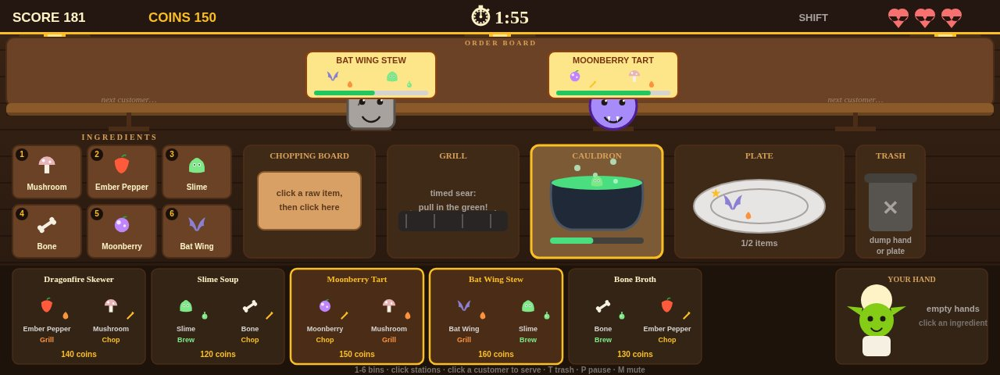

[](https://make.fun/bounty/best-cooking-game-20261125-0137)
[](https://make.fun/bounty/best-cooking-game-20261125-0137)
[](https://make.fun/bounty/best-cooking-game-20261125-0137)

# GRIM & GRAVY — Monster Tavern Kitchen

You are the goblin chef of a tavern where monsters come to eat. **Gobby** the goblin, **Blorp** the slime, **Vesper** the vampire bat and **Boulder** the golem sit at your counter, order off a menu of five impossible dishes, and lose patience fast. Chop it, grill it, brew it, plate it — and serve it before they storm out.

An entry for the [make.fun best cooking game bounty](https://make.fun/bounty/best-cooking-game-20261125-0137).



## How to play

Open `game/index.html` in a desktop browser, or serve the folder and open it:

```sh
node serve.ts
# then open http://localhost:8080
```

- **Click an ingredient bin (or press 1–6)** — pick it up raw.
- **Click a station** — the chopping board, the grill, or the cauldron — to prep it. Each recipe needs a specific prep: the knife, the flame, or the potion.
- **The grill is timed** — pull in the green window for a perfect sear (★, +50 points); wait too long and it burns.
- **Click the plate** — stack the two prepped items into the dish. A full plate glows **READY TO SERVE!**
- **Click a customer** — serve the dish that matches their ticket. Fast serves and perfect sears pay extra; combos stack.
- **T trash** — dump what is in your hand, or clear the plate. **P / Esc** — pause · **M** — mute · **R** — cook another shift.

A shift lasts 2:30. Three monsters walking out ends it early. The shift report rates you up to three stars.

## The menu

| Dish | Needs | Price |
| --- | --- | --- |
| Dragonfire Skewer | Ember Pepper, grilled + Mushroom, chopped | 140 |
| Slime Soup | Slime, brewed + Bone, chopped | 120 |
| Moonberry Tart | Moonberry, chopped + Mushroom, grilled | 150 |
| Bat Wing Stew | Bat Wing, grilled + Slime, brewed | 160 |
| Bone Broth | Bone, brewed + Ember Pepper, chopped | 130 |

The same ingredient can be prepped three ways — a mushroom chopped is not a mushroom grilled, and the ticket tells you which one the monster wants. The recipe book along the bottom lights up gold whenever a waiting customer orders that dish.

## Shots

The screenshots under `screenshots/` are real renders of the game's own code, staged deterministically with `?shot=` (`shots.json` lists them): the mid-shift cover (a dish mid-assembly, slime in the cauldron), the title, a plate ready to serve, and the shift report after a full 15-dish shift.

## Layout

- `game/` — the playable game as static files (`index.html` + ES modules under `src/`, one job per file)
- `main.ts` — the hand-in program: copies `game/` and `screenshots/` to `/output` and writes `dossier.json`
- `vendor/makefun-game.ts` — the kit's dossier library, unchanged
- `screenshots/` — 4 screenshots of the game, taken from its own code
- `serve.ts` — a tiny static server for local play-testing

All art is drawn in code on canvas and all sound is synthesised with the Web Audio API — no images, no audio files, no network requests. The whole game is static files under `game/`.

## License

MIT — see [LICENSE](LICENSE).
